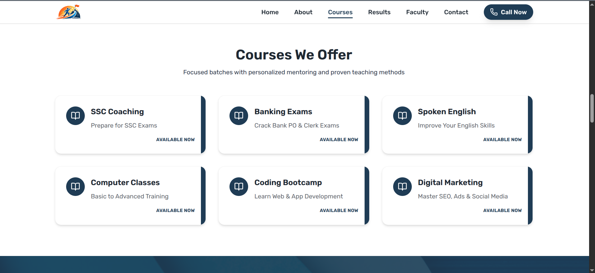

<!-- ==================== HEADER BANNER ==================== -->
<div align="center">
  
</div>
<!-- ==================== TYPING ANIMATION ==================== -->
<div align="center">
  <a href="https://nassar-group.vercel.app">
    
  </a>
</div>

<br />

<!-- ==================== STATUS & TECH BADGES ==================== -->
<div align="center">
  
  
  
  
</div>

<br />

<!-- ==================== QUICK NAVIGATION ==================== -->
<p align="center">
  <a href="#-about-the-platform"><b>About</b></a> •
  <a href="#-courses--academic-tracks"><b>Programs</b></a> •
  <a href="#-key-features--ux"><b>Features</b></a> •
  <a href="#-tech-stack"><b>Tech Stack</b></a> •
  <a href="#-architecture"><b>Architecture</b></a> •
  <a href="#-quick-start"><b>Quick Start</b></a>
</p>


## 🏛️ About The Platform

**Nassar Group** is a modern, high-converting educational and academic advisory web platform tailored for professionals, corporate teams, and postgraduate researchers across the Gulf region and Egypt.

The platform bridges the gap between **executive professional certifications** and **academic research guidance**, wrapped in a clean, trust-driven interface engineered for speed, accessibility, and seamless bilingual navigation.

---

## 🎯 Courses & Academic Tracks

The catalog is dynamically structured with real-time availability indicators (`AVAILABLE NOW` / `Soon`) and accreditation tags:

| Track / Program | Domain / Body | Focus Area | Status |
| :--- | :---: | :--- | :---: |
| **Human Resources** | `SHRM` | HR leadership, strategic workforce capabilities & SHRM-CP standards | 🟢 `AVAILABLE NOW` |
| **Project Management** | `PMI` | Planning, execution, governance & PMP-aligned methodologies | 🟢 `AVAILABLE NOW` |
| **Industrial Safety** | `ASIS` | Risk prevention, compliance & workplace physical security (PSP) | 🟢 `AVAILABLE NOW` |
| **Master's & Doctorate** | `POSTGRADUATE` | Academic & research guidance for candidates in Saudi universities | 🟢 `AVAILABLE NOW` |
| **Talent Development** | `ATD` | Learning strategies, coaching competencies & APTD growth systems | 🟡 `Soon` |
| **Accounting & Auditing** | `FINANCE` | Financial reporting, internal controls & audit readiness | 🟡 `Soon` |

---

## ✨ Key Features & UX

<table>
  <tr>
    <td width="50%">
      <h3>🌐 Full Bilingual Experience (AR / EN)</h3>
      <p>Instant language switching from the top navbar with automatic layout mirroring (LTR ↔ RTL) and localized content.</p>
    </td>
    <td width="50%">
      <h3>🌓 Adaptive Dark & Light Mode</h3>
      <p>Built-in theme switcher preserving brand contrast between deep navy (<code>#14263b</code>) and warm gold accents (<code>#c59b27</code>).</p>
    </td>
  </tr>
  <tr>
    <td width="50%">
      <h3>⚡ Direct Conversion Funnel</h3>
      <p>Integrated <b>Call Now</b>, <b>WhatsApp Chat</b>, and a persistent floating quick-action button for frictionless lead generation.</p>
    </td>
    <td width="50%">
      <h3>🏆 Trust & Methodology Architecture</h3>
      <p>Dedicated showcases for the 6-pillar teaching methodology, key metrics (<b>1000+ Students</b>, <b>10+ Years Experience</b>), and official accreditation badges.</p>
    </td>
  </tr>
</table>

---

## 🛠️ Tech Stack

<div align="center">
  
  
  
  
  
</div>

<br />

- **Framework:** `Next.js` (App Router) & `React` for fast rendering, clean routing, and modular UI composition.
- **Language:** `TypeScript` for strict type safety across course data, translations, and UI props.
- **Styling:** `Tailwind CSS` for utility-first responsive design, custom brand color tokens, and dark mode support.
- **Deployment:** `Vercel` for edge caching, instant previews, and zero-downtime CI/CD.

---

## 📸 Platform Walkthrough

<details>
  <summary><b>🖼️ Click to expand UI Screenshots</b></summary>
  <br />

  | Section | Preview |
  | :--- | :---: |
  | **Hero & Navigation** |  |
  | **About & Value Pillars** |  |
  | **Courses Catalog** |  |
  | **Teaching Methodology** |  |
  | **Accreditations & Partners** |  |
  | **Contact & Interactive Map** |  |
</details>

---

## 📁 Architecture

```bash
nassar-group/
├── 📂 app/                 # Next.js App Router pages, layouts & global styles
├── 📂 components/          # Modular UI sections (Navbar, Hero, Courses, Methodology, Contact)
├── 📂 content/             # Structured bilingual data (EN/AR) for tracks, stats & accreditations
├── 📂 lib/                 # Utility functions, theme helpers & formatting logic
├── 📂 public/              # Static brand assets, accreditation logos & screenshots
└── 📂 types/               # TypeScript interfaces for courses, badges & localization